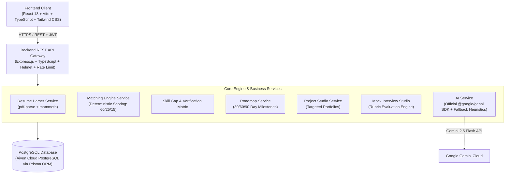

# SkillBridge AI — System Architecture & Design Specification

> **Core Tagline:**  
> *"Don't just discover whether you're job-ready. Discover exactly how to become job-ready."*

---

## 1. High-Level Architecture Overview

SkillBridge AI is engineered with a strict separation of concerns, decoupling the client single-page application (SPA), the REST API gateway, relational data persistence, and AI augmentation services.

---

## 2. Explainable Deterministic Matching Formula

A core principle of SkillBridge AI is that **AI does not fabricate match scores**. Match percentages are calculated deterministically on the backend with documented mathematical weights:

$$\text{Overall Match Score} = (S \times 0.60) + (E \times 0.25) + (D \times 0.15)$$

Where:

1. **$S$ = Technical Skills Score (60% Weight):**
   - For every required skill in the job description:
     - Exact normalized match = $1.0\text{ point}$
     - Related / technology-family partial match (e.g. PostgreSQL $\leftrightarrow$ SQL, React Native $\leftrightarrow$ React, Express $\leftrightarrow$ Node) = $0.6\text{ point}$
     - Missing = $0.0\text{ point}$
   - Preferred / nice-to-have skill match bonus: up to $+10\%$
   - $S = \min\left(100, \left(\frac{\text{Points Earned}}{\text{Total Required Skills}}\right) \times 100 + \text{Preferred Bonus}\right)$

2. **$E$ = Practical Experience Alignment (25% Weight):**
   - Compares candidate verified years against required years:
     - If $\text{candidateYears} \ge \text{requiredYears}$, $E = 100\%$
     - If $\text{candidateYears} < \text{requiredYears}$, $E = \max\left(40, \text{round}\left(\frac{\text{candidateYears}}{\text{requiredYears}} \times 100\right)\right)$

3. **$D$ = Education Alignment (15% Weight):**
   - Compares candidate highest degree level against target credentials (PhD: 100, Master: 95, Bachelor: 90, Associate/Diploma/Self-taught: 75).

Every match report stores this complete mathematical proof and generates prioritized action items directly tied to missing skills.

---

## 3. Skill Gap & Verification Hierarchy

SkillBridge AI prevents self-inflation by enforcing a 4-tier verification hierarchy:

| Level | Source | Meaning | Weight in Readiness Dial |
|---|---|---|---|
| 1 | `SELF_REPORTED` | User manually typed in skill | Baseline (0.5x) |
| 2 | `RESUME_EXTRACTED` | Parsed from uploaded PDF/DOCX | Intermediate (0.8x) |
| 3 | `PROJECT_VERIFIED` | Completed recommended portfolio project | High (1.0x) |
| 4 | `ASSESSMENT_VERIFIED`| Passed structured technical evaluation | High (1.0x) |

---

## 4. AI Augmentation & Graceful Degradation (Zero Budget Guarantee)

- The backend integrates the official **Google Gemini SDK (`@google/genai`)** using the `gemini-2.5-flash` model.
- **Fail-Safe Fallbacks:** Every service (Resume Parsing, Job Extraction, Roadmaps, Project Recommendations, Mock Interviews) includes a deterministic fallback engine. If the `GEMINI_API_KEY` is omitted, exhausted, or experiences rate limits, the entire platform continues functioning smoothly without crashing.

---

## 5. Security & Reliability Architecture

- **Stateless Authentication:** JSON Web Tokens (JWT) signed with HMAC SHA-256 and stored in secure browser storage.
- **Password Hashing:** Passwords hashed using `bcryptjs` with 12 salt rounds.
- **Data Isolation:** User ID ownership checks enforced on every database query. Users can never view or manipulate another user's resumes, jobs, or reports.
- **Defense in Depth:** Helmet HTTP security headers, CORS origin whitelisting, Express Rate Limiting (300 req / 15 min), and Zod runtime schema validation.
- **Zero Exposed Secrets:** API keys and connection strings remain strictly on the server side.
